# TEST AUTOMATIC POST RESULTS — complete content preview

Offline content preview. Custom emoji remain as template tokens here; CM resolves them through the TEST renderer. No Discord delivery is performed.

## TEST / Nordschleife practice and forecast

### Message 1 — Practice Highlights

TEST AUTOMATIC POST RESULTS

#### 🏁 NORDSCHLEIFE ROUND 4 - PRACTICE HIGHLIGHTS

{{emoji:checked}} ⏱️ **EVENT-SESSION SNAPSHOT**
Practice export dated <t:1795271580:F>.
**6 drivers | 9 recorded laps | 1 classified best lap.**
This is the event session, not the whole week of practice.

{{emoji:checked}} 🏎️ **THE CLASSIFIED BENCHMARK**
Andy Thompson records **8:21.031** in the BMW M4 GT3 EVO.
He is the only driver with a classified best lap in this export.
The other five have a no-time sentinel, not a 277-hour lap.

{{emoji:checked}} 🔁 **WHO PUT LAPS IN**
• Andy Thompson, GreEZ and Otherside: **2 laps each**.
• Eugene Mulin, LilCoughDrop and Kaasglenneman: **1 each**.
These are recorded lap counts, not valid flying-lap counts.

{{emoji:checked}} 🤝 **THE TEAM SAMPLE**
MMMNuts records **3 laps** across Eugene and Otherside.
Damsels in Distress and Lambda Racing record two each.
The sample cannot support a fastest-model ranking or a full-week prediction.

https://es2.assettohosting.com:10190/results/2026_11_21_15_33_PRACTICE

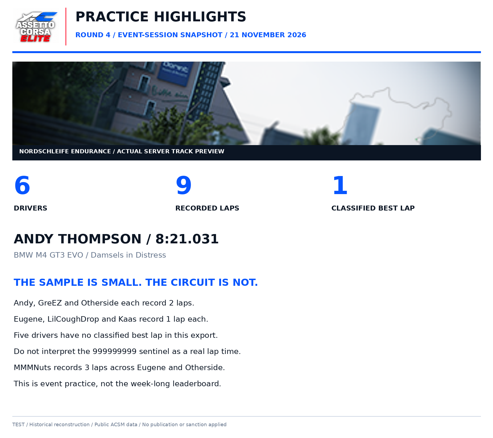

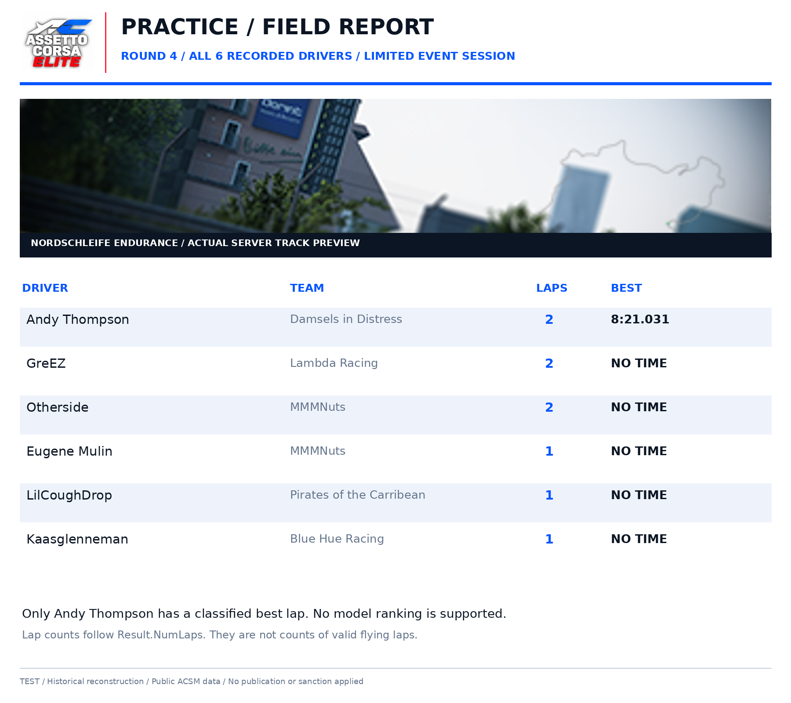

### Message 2 — Nordschleife Forecast

TEST AUTOMATIC POST RESULTS

#### ⚡ NORDSCHLEIFE ROUND 4 - FORECAST ⚡

{{emoji:checked}} 🔮 **THREE ROUNDS. THREE WINNERS.**
Versthappening won VIR. Kaasglenneman won Daytona.
LilCoughDrop won Road America by **4.128s**.
The Nordschleife adds **90 minutes + 1 lap** to that unfinished argument.

{{emoji:checked}} ⏱️ **DRIVERS TO WATCH**
• LilCoughDrop: **73 points**, leading by 23.
• Kaasglenneman: **50**, three ahead of Versthappening.
• Versthappening: **47**, after second at Road America.
Three poles in three rounds put the Mustang on the watch list.

{{emoji:checked}} 🤝 **THE TEAM BATTLE**
• Pirates of the Carribean: **81 points**.
• Blue Hue Racing: **62**, 19 behind.
• The Heart of Binning: **52**.
• Burnout\_Baddies: **51**.
One point separates the Lexus and Audi teams.
Both drivers' finishes can change that order.

{{emoji:checked}} 🌗 **THE UNKNOWNS**
A mandatory stop and the day/night cycle add decisions to the lap time.
The event-practice snapshot has only one classified best lap.
It cannot identify a reliable favourite. Neither can shouting louder in chat.

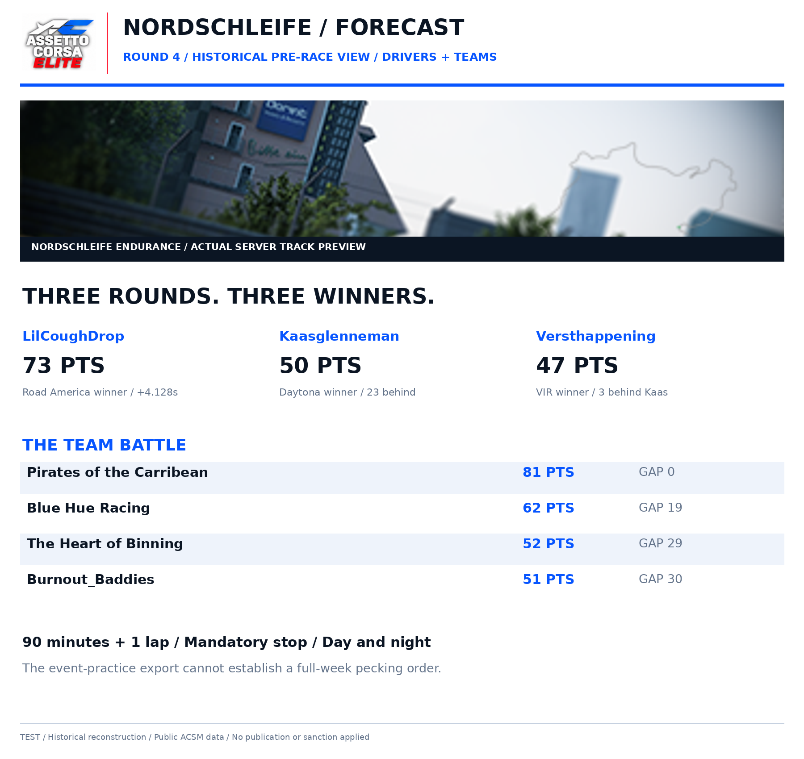

## TEST / Round 4 - Pre-race briefing

### Message 1 — Pre-Race Briefing

TEST AUTOMATIC POST RESULTS

#### ⚡ NORDSCHLEIFE ROUND 4 - PRE-RACE BRIEFING ⚡

{{emoji:checked}} 📅 **RACE DAY**
<t:1795274100:F>
Layout: **Nordschleife Endurance**.

{{emoji:checked}} ⏱️ **SCHEDULE**
<t:1795267800:t> - Practice | 60 minutes
<t:1795271400:t> - Qualifying | 45 minutes
<t:1795274100:t> - Race | **90 minutes + 1 lap**

{{emoji:checked}} ⛽ **ONE MANDATORY PIT STOP**
Opens 15 minutes after the start. Closes 10 minutes before the 90-minute timer expires.
**Window: elapsed minute 15 to minute 80.**
Complete the mandatory stop inside the window.

{{emoji:checked}} 🌇 **CONDITIONS**
Day/night cycles. Fixed air and track temperatures.
Damage multiplier: **30%**.

{{emoji:checked}} 🚨 **PITLANE**
Collisions in the pits are enabled. Leave room around pit boxes.
Pitlane speeding results in a **drive-through penalty**.

{{emoji:checked}} 🔮 **THE FORECAST**
Versthappening won VIR. Kaasglenneman won Daytona.
LilCoughDrop won Road America by **4.128s**.
Three rounds, three winners.

{{emoji:checked}} 📊 **THE CHAMPIONSHIP**
LilCoughDrop **73 pts** | Kaasglenneman **50** | Versthappening **47**.
Pirates **81** | Blue Hue **62** | The Heart of Binning **52** | Burnout\_Baddies **51**.
Three points split P2 and P3. One point divides the Lexus and Audi teams.

https://es2.assettohosting.com:10190/live-timing

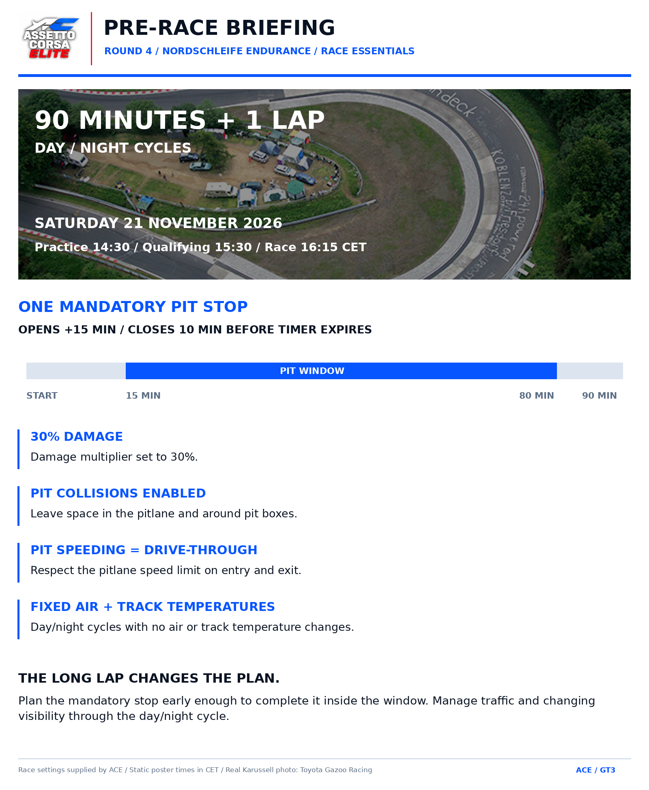

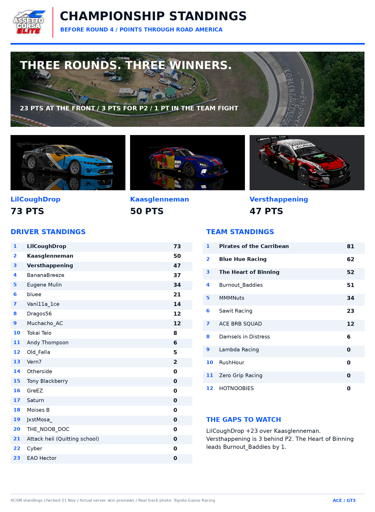

## TEST / Round 4 - Race day announcement

### Message 1 — Race day essentials

TEST AUTOMATIC POST RESULTS

#### 🏁 NORDSCHLEIFE ROUND 4 - RACE DAY

{{emoji:checked}} 📅 **TODAY'S RACE**
<t:1795274100:F> | Nordschleife Endurance

{{emoji:checked}} ⏱️ **SCHEDULE**
<t:1795267800:t> Practice | <t:1795271400:t> Qualifying
<t:1795274100:t> Race - **90 minutes + 1 lap**

{{emoji:checked}} ⛽ **MANDATORY STOP**
One stop. Pit window: **elapsed minute 15 to minute 80**.

{{emoji:checked}} 🚨 **ESSENTIALS**
• Day/night cycles. Fixed air and track temperatures.
• 30% damage. Collisions enabled in pits.
• Pitlane speeding = drive-through.

{{emoji:checked}} 🔮 **THE FIGHT**
LilCoughDrop leads on 73 points.
Kaasglenneman has 50; Versthappening has 47.
Pirates 81 | Blue Hue 62 | The Heart of Binning 52 | Burnout\_Baddies 51.

## TEST / Round 4 - Nordschleife results

### Message 1 — Qualifying Report

TEST AUTOMATIC POST RESULTS

#### 🏁 NORDSCHLEIFE ROUND 4 - QUALIFYING REPORT

{{emoji:checked}} ⏱️ **FOUR ROUNDS. FOUR POLES.**
LilCoughDrop takes pole in **8:00.926**.
Four rounds, four qualifying wins for the Mustang.

{{emoji:checked}} 💪 **THE FRONT ROW**
• Eugene Mulin - P2, **8:04.323**, +3.397s.
• Kaasglenneman - P3, **8:04.792**.
Just **0.469s** separates the BMW and AMG.

{{emoji:checked}} 🔵 **THE TEAM STORY**
Blue Hue Racing places both AMGs in the top four.
Kaasglenneman takes P3. Dragos56 takes P4.
MMMNuts qualifies Eugene P2 and Otherside P10.

{{emoji:checked}} 🔥 **THE CLOSE FIGHT**
Andy Thompson takes P5 in **8:17.599**.
Muchacho\_AC is only **0.209s** behind in P6.
Old\_Fella takes P7. Seven drivers are under 8:20.

{{emoji:checked}} 📊 **THE SESSION**
**15 drivers | 42 laps | 11 classified times.**
Versthappening has no qualifying entry and starts the race P16.

https://es2.assettohosting.com:10190/results/2026_11_21_16_22_QUALIFY

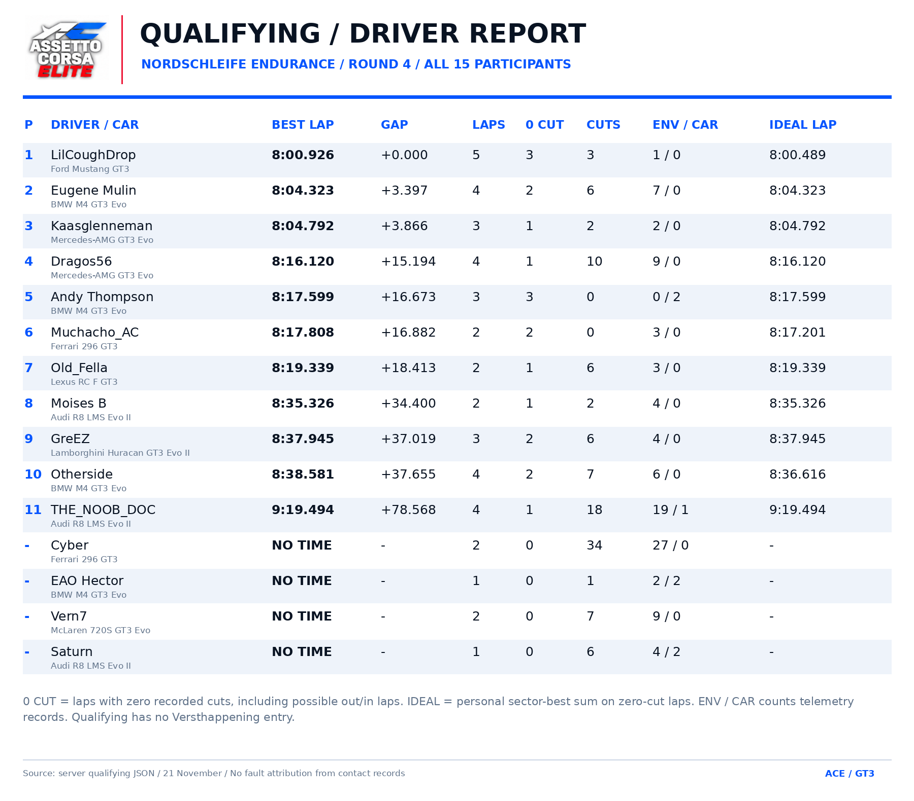

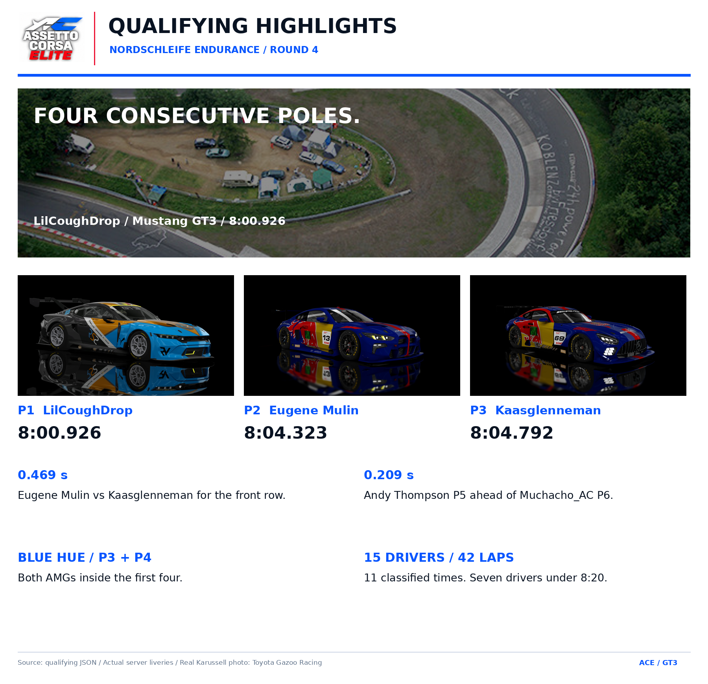

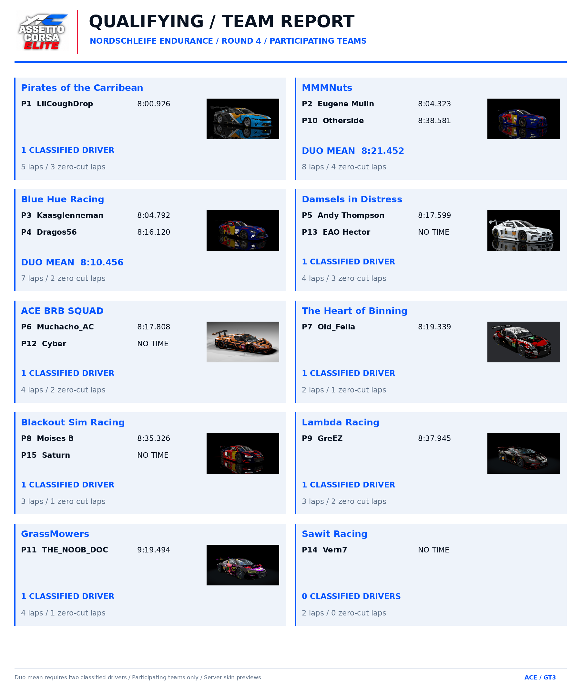

### Message 2 — Race Results

TEST AUTOMATIC POST RESULTS

#### ⚡ NORDSCHLEIFE ROUND 4 - RACE RESULTS ⚡

{{emoji:checked}} 🏁 **BACK-TO-BACK FOR THE MUSTANG**
LilCoughDrop wins in **1:38:32.412**, completing **12 laps**.
Pole, victory and fastest lap (**8:01.486**) go to the Mustang.

{{emoji:checked}} 🏆 **THE INDIVIDUAL STORY**
• Eugene Mulin - P2, **+46.962s**.
• Versthappening - **P16 to P3**, gaining 13 places.
• Muchacho\_AC - P4, **6.674s** ahead of Dragos56.
• Otherside - **P10 to P7**.
• Kaasglenneman - three laps completed, classified P16.

{{emoji:checked}} 🤝 **THE TEAM STORY**
• Pirates of the Carribean - **31 pts**.
• MMMNuts - **24 pts**, with P2 and P7.
• The Heart of Binning - **15 pts**.
• ACE BRB SQUAD - **12 pts**.
• Blue Hue Racing - **10 pts**.
Two scoring BMWs give MMMNuts its strongest round so far.

{{emoji:checked}} 📊 **THE CHAMPIONSHIP**
LilCoughDrop leads on **104 pts**.
Versthappening takes P2 on **62**.
Eugene Mulin takes P3 on **52**, two ahead of Kaas.
The Pirates lead the team table by **40 points**.

https://es2.assettohosting.com:10190/results/2026_11_21_18_16_RACE

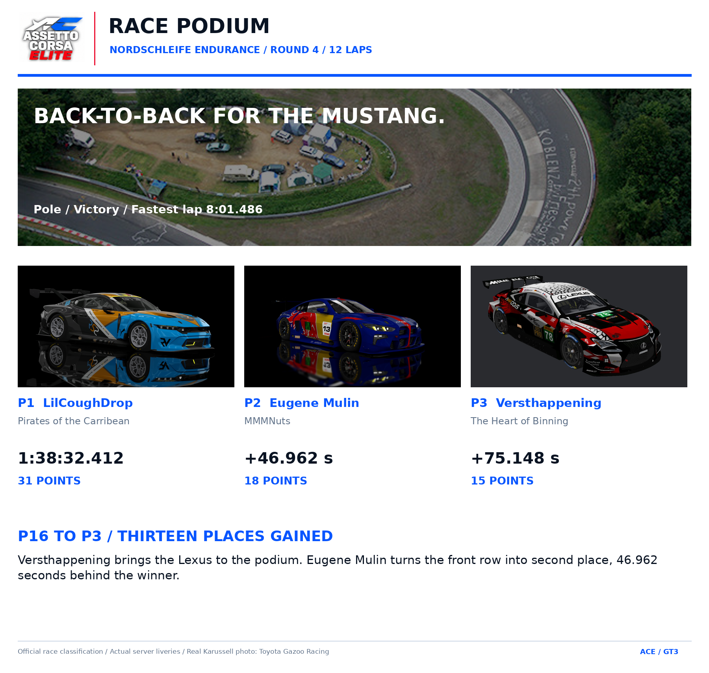

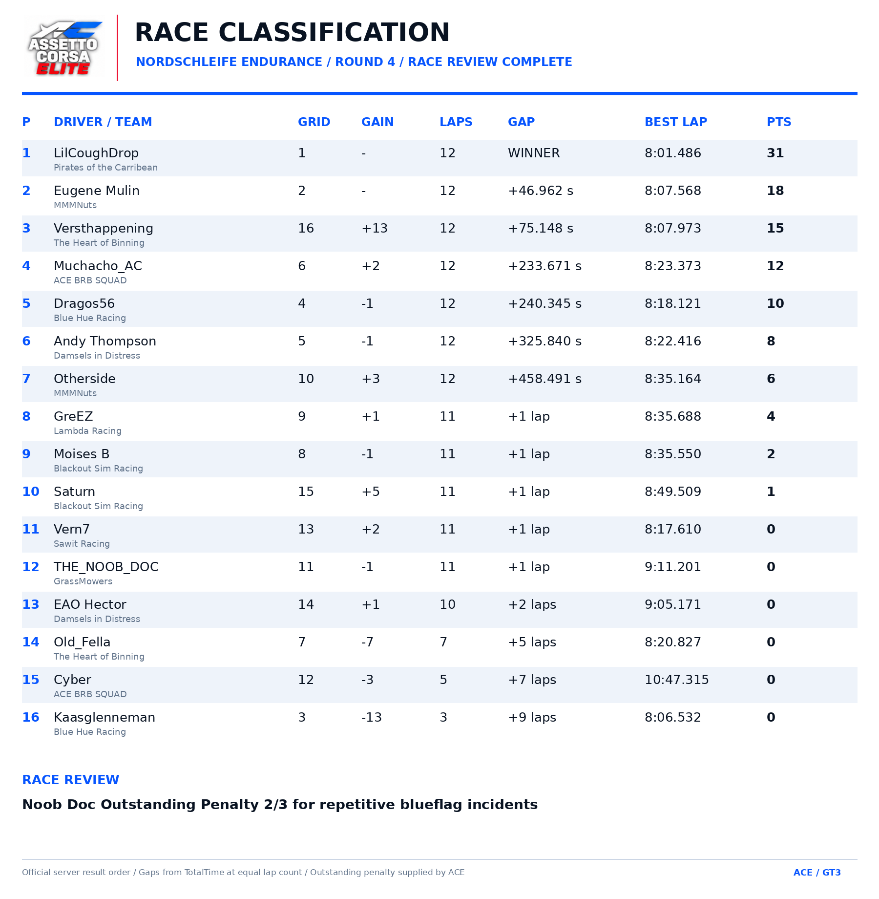

### Message 3 — Stewarding Review

TEST AUTOMATIC POST RESULTS

#### ⚖️ NORDSCHLEIFE ROUND 4 - STEWARDING REVIEW

{{emoji:checked}} 📋 **REVIEW COMPLETE**
The organizer has supplied the final review decision.

{{emoji:checked}} 🚨 **DECISIONS BY DRIVER**
THE\_NOOB\_DOC
Outstanding Penalty **2/3** for repetitive blueflag incidents.

{{emoji:checked}} 📊 **RESULT IMPACT**
The supplied decision carries no time or points adjustment.
The official classification and championship points remain the basis of the Results sequence.

### Message 4 — Race Insights

TEST AUTOMATIC POST RESULTS

#### ⚡ NORDSCHLEIFE ROUND 4 - RACE INSIGHTS ⚡

{{emoji:checked}} 🔁 **CONSISTENCY - TOP 5**
1. Eugene Mulin - **99.18% | 3.9905s**
2. Versthappening - **98.96% | 5.0836s**
3. LilCoughDrop - **98.89% | 5.3374s**
4. Muchacho\_AC - **98.68% | 6.6648s**
5. Old\_Fella - **98.59% | 7.0823s**
SimResults compares best lap with its selected average of other laps.
Old Fella completed seven laps; consistency ranks the recorded sample.

{{emoji:checked}} 📈 **THE POSITION STORY**
• LilCoughDrop leads at the end of **11 of 12 laps**.
• Eugene leads at lap **5**.
• Versthappening gains **13 places**, P16 to P3.
The Lexus is P3 at the first completed lap. The chart shows completed-lap observations.

{{emoji:checked}} ⏱️ **THE OFFICIAL GAPS**
• P1 to P2 - **46.962s**.
• P2 to P3 - **28.186s**.
• P4 to P5 - **6.674s**.

{{emoji:checked}} 📊 **READING THE POSTERS**
Positions use SimResults. Gaps use cumulative recorded lap times at equal lap counts, including pit laps.
Retired drivers stop at their last lap. Official finishing gaps are on the classification poster.

https://simresults.net/remote?result=https%3A%2F%2Fes2.assettohosting.com%3A10190%2Fresults%2Fdownload%2F2026_11_21_18_16_RACE.json

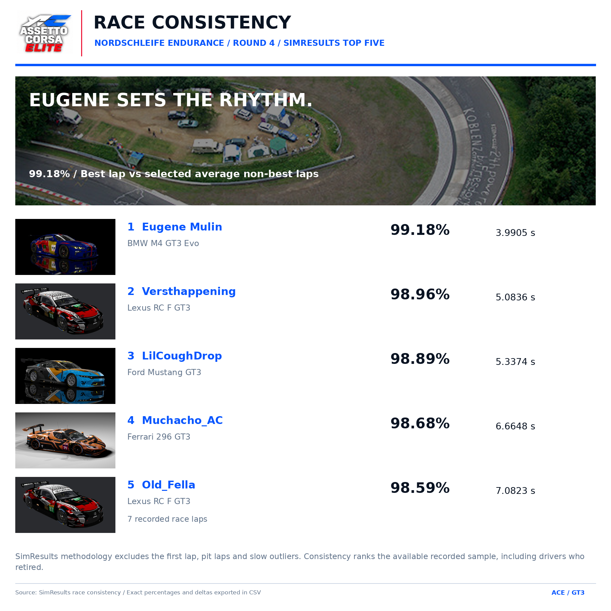

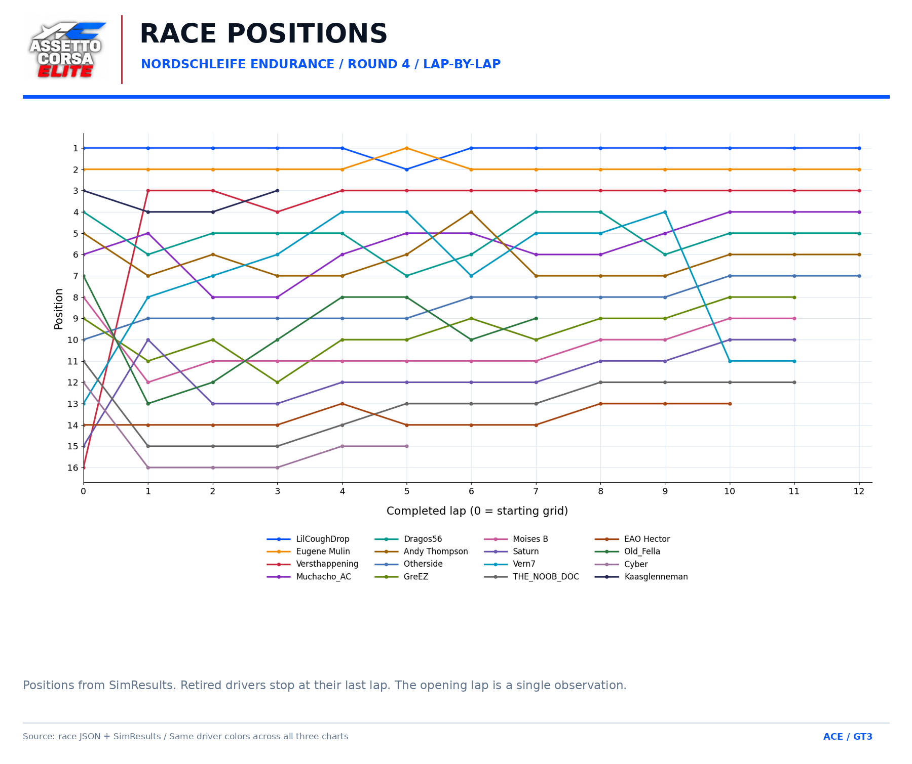

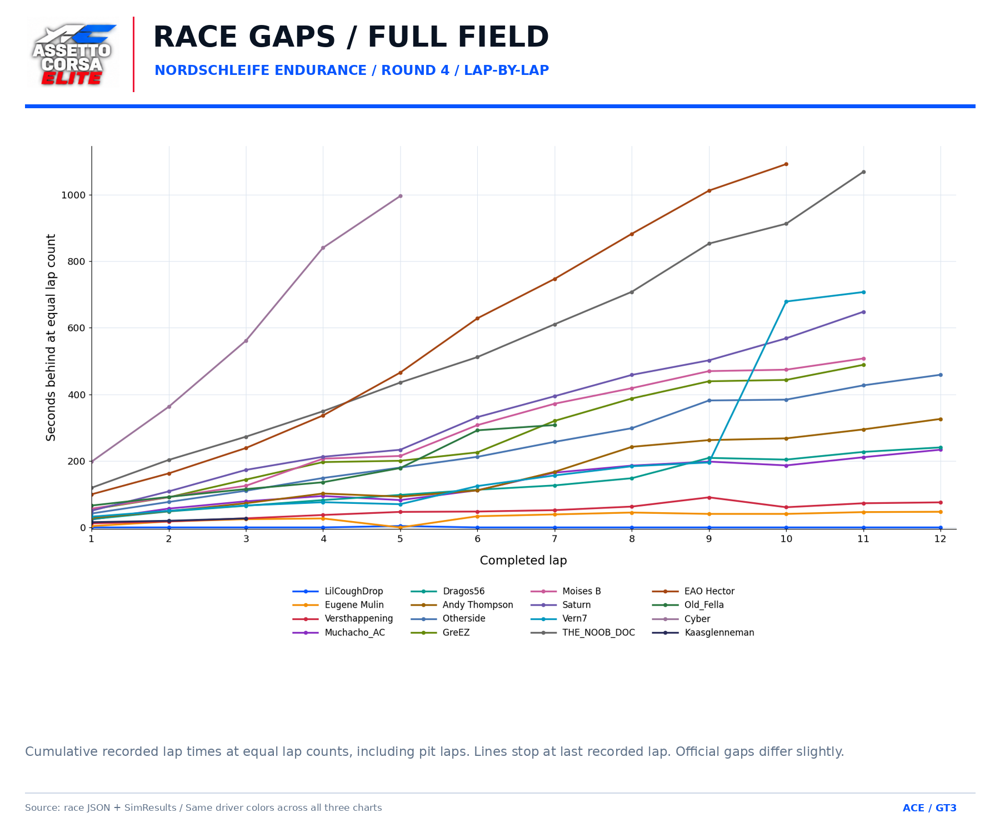

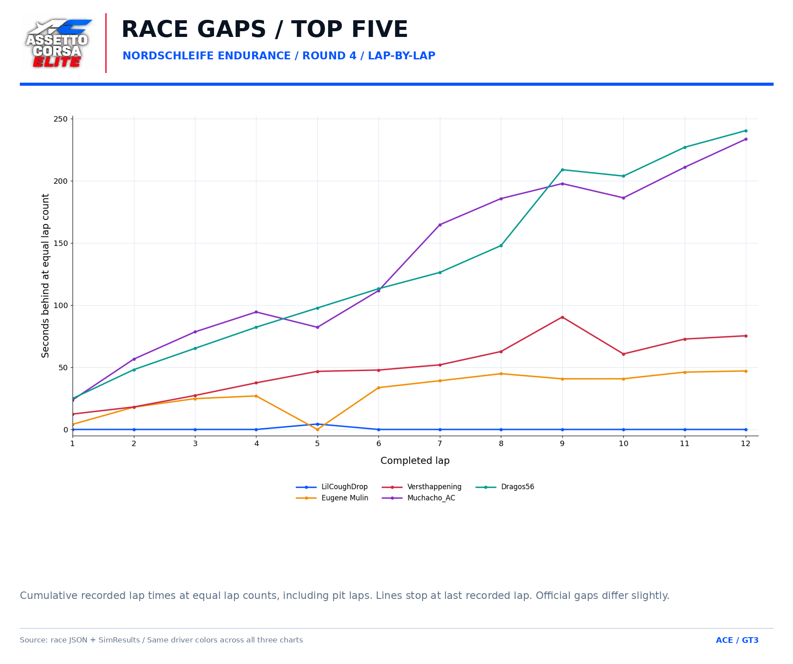

### Message 5 — Championship Standings

TEST AUTOMATIC POST RESULTS

#### ⚡ LEAGUE 04 - STANDINGS AFTER ROUND 4 ⚡

{{emoji:checked}} 🏆 **DRIVER STANDINGS**
1. LilCoughDrop - **104 pts**
2. Versthappening - **62**
3. Eugene Mulin - **52**
4. Kaasglenneman - **50**
5. BananaBreeze - **37**
6. Muchacho\_AC - **24**
7. Dragos56 - **22**
8. bluee - **21**

{{emoji:checked}} 🤝 **TEAM STANDINGS**
1. Pirates of the Carribean - **112 pts**
2. Blue Hue Racing - **72**
3. The Heart of Binning - **67**
4. MMMNuts - **58**
5. Burnout\_Baddies - **51**
6. ACE BRB SQUAD - **24**
7. Sawit Racing - **23**
Both posters contain the complete standings.

{{emoji:checked}} 📈 **WHO MOVED**
• Versthappening moves to P2.
• Eugene climbs from fifth to third.
• Muchacho climbs from ninth to sixth.
• MMMNuts moves ahead of Burnout\_Baddies.
• ACE BRB SQUAD moves one point ahead of Sawit Racing.

{{emoji:checked}} 🧮 **THE GAPS**
The driver lead grows from **23 to 42 points**.
The team lead grows from **19 to 40**.
Blue Hue has **5 points** over the Lexus team.
MMMNuts is another **9 points** behind.

https://es2.assettohosting.com:10190/championship/8a40b3b7-bf46-4a50-8658-1245d7524d16

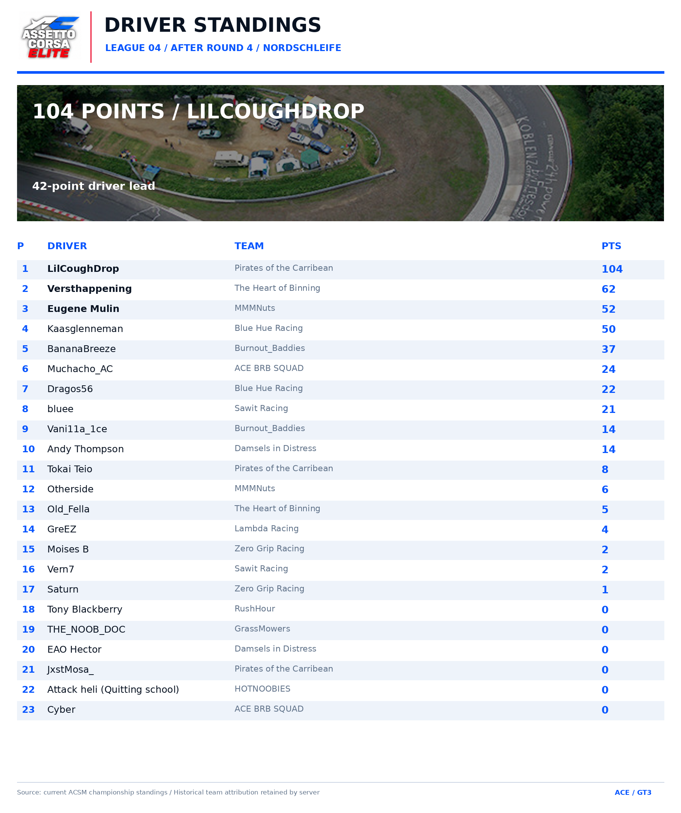

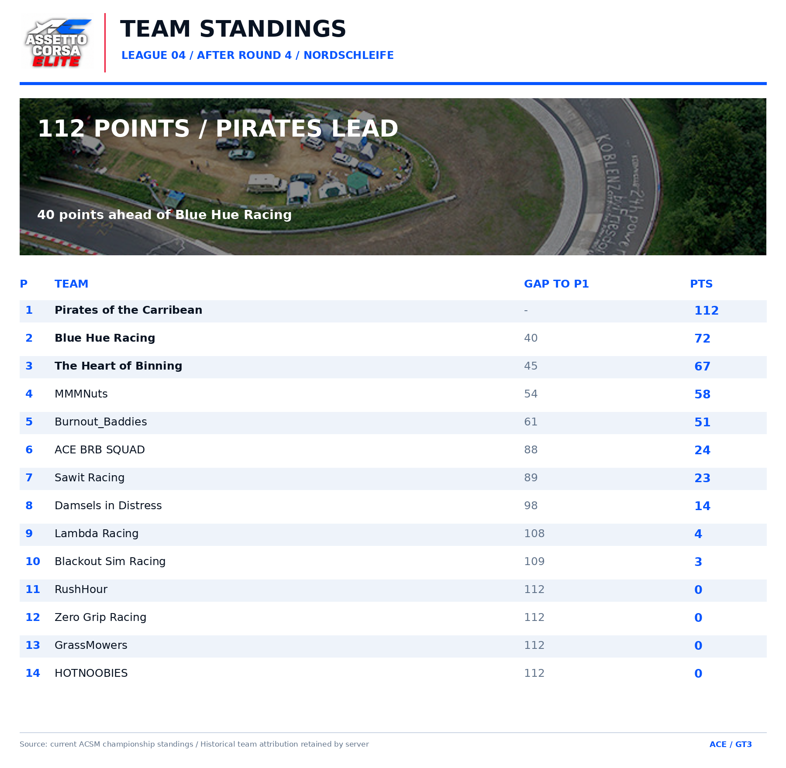

### Message 6 — Portimao Forecast

TEST AUTOMATIC POST RESULTS

#### ⚡ PORTIMAO ROUND 5 - FORECAST ⚡

{{emoji:checked}} 🔮 **WHAT IS AT STAKE**
LilCoughDrop arrives with two consecutive wins and a **42-point lead**.
Four poles. Four fastest race laps. Portimao gives the field another shot at the Mustang.

{{emoji:checked}} ⏱️ **DRIVERS TO WATCH**
• Versthappening - **62 pts**, after P16 to P3.
• Eugene Mulin - **52 pts**, after P2 and the best race consistency.
• Kaasglenneman - **50 pts**, after a three-lap race.
Only **2 points** separate Eugene and Kaas.

{{emoji:checked}} 🤝 **THE TEAM BATTLE**
• Pirates of the Carribean - **112 pts**.
• Blue Hue Racing - **72**.
• The Heart of Binning - **67**.
• MMMNuts - **58**, after a 24-point round.
The Lexus team is five points behind the AMGs.
Two scoring BMWs have brought MMMNuts back into the chase.

{{emoji:checked}} 🧮 **ONE POINT APART**
ACE BRB SQUAD has **24 points**. Sawit Racing has **23**.
Muchacho's Ferrari P4 changed the order. Another strong finish could move both tables again.

{{emoji:checked}} 🌦️ **THE UNKNOWNS**
Portimao practice will reveal who carries the pace forward.
Timings and race settings will appear in the next pre-race briefing once confirmed.

https://es2.assettohosting.com:10190/live-timing

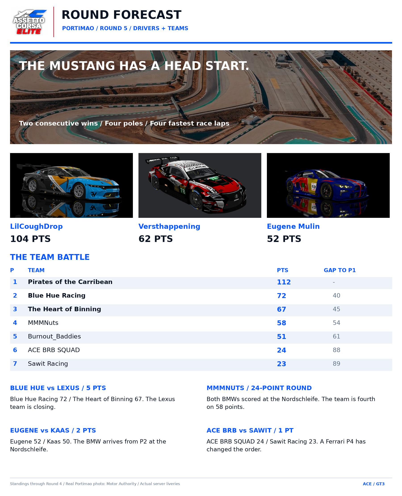

## TEST / Round 4 - Results announcement

### Message 1 — Results summary

TEST AUTOMATIC POST RESULTS

#### 🏁 NORDSCHLEIFE ROUND 4 - RESULTS

{{emoji:checked}} 📊 **FIND THE COMPLETE RESULTS**
➡️ **[Find the complete results in Results]({{link:results_start}})**

{{emoji:checked}} 🏆 **THE PODIUM**
1. LilCoughDrop - 12 laps, **1:38:32.412**
2. Eugene Mulin - **+46.962s**
3. Versthappening - **P16 to P3**
Pole and fastest lap (**8:01.486**) also go to LilCoughDrop.

{{emoji:checked}} 🤝 **THE TEAM STORY**
Pirates score **31 points**. MMMNuts scores **24** with P2 and P7.
The Heart of Binning takes **15**; ACE BRB SQUAD **12**; Blue Hue **10**.

{{emoji:checked}} 📈 **THE STANDINGS**
LilCoughDrop 104 | Versthappening 62 | Eugene 52.
Pirates 112 | Blue Hue 72 | The Heart of Binning 67.

{{emoji:checked}} 🚨 **RACE REVIEW**
Noob Doc Outstanding Penalty 2/3 for repetitive blueflag incidents

### Message 2 — Individual and team results

TEST AUTOMATIC POST RESULTS

### Message 3 — Remaining results posters

TEST AUTOMATIC POST RESULTS

